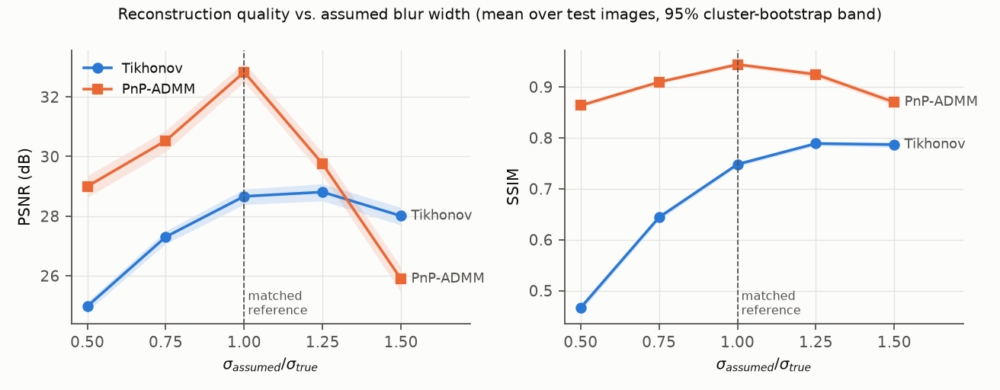
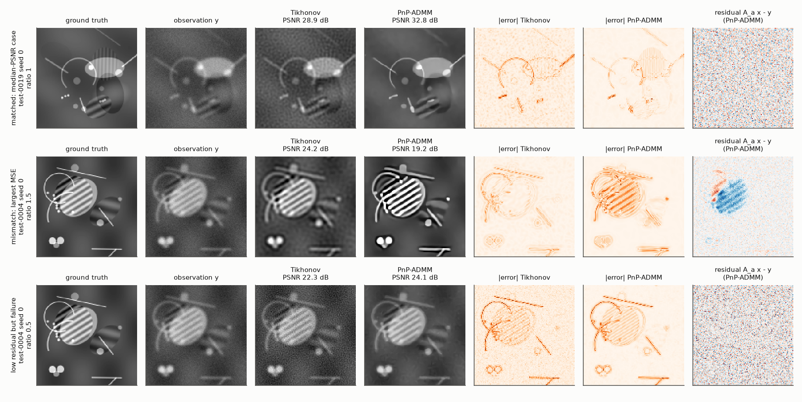

# Reliable Reconstruction under Measurement Mismatch

What happens to image reconstruction when the algorithm assumes the wrong blur, and can
ground-truth-free scores tell which reconstructions went wrong? A small, fully reproducible
simulation study: Gaussian deblurring with **Tikhonov** and **Plug-and-Play ADMM** (with a
CNN denoiser trained here), on synthetic phantoms, with an optional public-CT-image extension.

> Portfolio project. Implementation and experiments were assisted by LLM-based coding tools; see
> [AI_USAGE.md](AI_USAGE.md). This is not a novel method and not a clinical study.
> README numbers are generated from `results/*.csv` (`python -m reconstruction_mismatch report`).

## Research questions

1. **Accuracy under mismatch**: how do PSNR/SSIM change as σ_assumed/σ_true goes from 0.5 to 1.5 (σ_true = 1.5 px, noise σ = 0.02)?
2. **Consistency vs. accuracy**: does a small data residual under the assumed operator mean a good reconstruction?
3. **Label-free failure scores**: do the relative residual, residual autocorrelation and operator sensitivity rank large-error reconstructions first, beyond random review and beyond knowing the mismatch level?

## Key results (full profile: 48 test phantoms × 3 noise seeds, CPU)

- **PnP-ADMM is better when the operator is right but much less tolerant of mismatch.** At the matched operator it beats Tikhonov by
  4.17 dB
  (32.83 vs
  28.66 dB). At σ_assumed/σ_true = 1.5 it trails Tikhonov by
  2.12 dB
  (change vs. its own matched result: -6.94 dB vs
  -0.66 dB for Tikhonov).
- **A low residual does not mean a correct image.** The relative residual increases with σ_assumed whatever the error. It is lowest
  where Tikhonov fails most, and its pooled AUROC for Tikhonov failures is
  0.10 (worse than random).
- **Pooled failure detection mostly reflects the mismatch level.** Replacing a score by its condition mean
  ("condition-only") gives the same or better pooled capture: e.g. Tikhonov autocorrelation
  0.84 vs
  condition-only 0.90
  at 20% review.
- **Within a condition, operator sensitivity carries a modest signal.** Reviewing 20% catches
  0.33
  [0.24,
  0.45] of the
  worst-20% PnP reconstructions (random 0.20). The intervals are exploratory (48 images).

<figure><figcaption>PSNR / SSIM vs. assumed blur width (95% image-level bootstrap bands).</figcaption></figure>

<figure><figcaption>Fixed-rule examples. Middle row: PnP over-sharpens when the blur is over-estimated. Bottom row: a PnP failure whose residual looks like white noise.</figcaption></figure>

Full write-up: [reports/report.pdf](reports/report.pdf) (source: [reports/report.md](reports/report.md)).

## Quick start

```bash
python -m venv .venv
.venv\Scripts\activate                      # macOS/Linux: source .venv/bin/activate
pip install torch --index-url https://download.pytorch.org/whl/cpu
pip install -e ".[test]"
pytest -m "not slow"                        # numerical verification (~1 min)
python -m reconstruction_mismatch reproduce --profile smoke   # plumbing check, ~2 min
python -m reconstruction_mismatch reproduce --profile quick   # 12 images x 2 seeds; ~13 min (uses the committed denoiser)
```

`--profile full` reproduces the numbers above (~55 min on a 4-core laptop CPU). The trained
denoiser is committed (`results/checkpoints/`, sha256-checked) and restored automatically when its
cache key (training data + config + code hash) matches; otherwise it is retrained (~35 min).
A forced recompute of the quick profile (tuning + reconstructions) reproduced every non-timing
value of `results/quick/per_image.csv` bit-for-bit on this machine. Commands: `generate-data`, `train-denoiser`, `tune`, `run`,
`evaluate`, `summarize`, `plot`, `report`, `reproduce`. Each writes to `results/<profile>/`
(resolved config, environment and code hashes, data hashes, checkpoint hash, per-image CSV,
stage status and logs). Interrupted runs resume from cached stages, and the cache keys include data,
config, checkpoint and code hashes.

Optional extensions (opt-in downloads):

```bash
python -m reconstruction_mismatch reproduce --profile full  --config configs/extensions/medmnist_organc.yaml  # 287.5 MB CC BY 4.0 CT slices
python -m reconstruction_mismatch reproduce --profile quick --config configs/extensions/ffdnet_kair.yaml      # 1.95 MB MIT pretrained denoiser
```

## Repository map

```
configs/            base.yaml (= full), profiles/{smoke,quick,full}.yaml, extensions/
src/reconstruction_mismatch/
  operators/        circular Gaussian blur (FFT), exact adjoint, spatial reference
  reconstruction/   Tikhonov (closed form), PnP-ADMM
  denoisers/        small residual CNN + training, KAIR FFDNet topology, identity
  data/             synthetic phantoms, splits, observation simulation, OrganCMNIST loader
  metrics/          PSNR/SSIM, label-free scores, failure-capture metrics
  experiments/      pipeline stages, reconstruction + scoring, analysis/bootstrap
  plotting/ reporting/
scripts/            check_iterations.py (validation-only K check)
tests/              pytest suite (numerical checks, API boundary, smoke end-to-end)
results/            CSV/JSON/figures per profile (committed); artifacts/ = data & caches (ignored)
reports/            report.md / .html / .pdf, templates
```

## Limitations (short)

Synthetic phantoms, isotropic Gaussian blur, circular boundaries and white noise. Only the
blur width is mismatched. 48 test images. One small CNN prior tuned at the matched operator.
σ_true is fixed, which confounds pooled evaluation. Scores are not calibrated uncertainties.
Details: report §9.

## 한국어 요약

**측정 연산 불일치 하의 신뢰할 수 있는 복원.** 실제 blur(σ_true = 1.5 px)와 복원 알고리즘이 가정한
blur(σ_assumed)가 다를 때 Tikhonov와 PnP-ADMM(직접 학습한 소형 CNN denoiser)의 복원 정확도가 어떻게
변하는지, 그리고 정답 없이 계산하는 점수(상대 잔차, 잔차 자기상관, 연산자 민감도)가 큰 오류를 먼저
찾아내는지 합성 영상으로 재현 가능하게 평가했다.
- 정확한 연산자에서는 PnP가 Tikhonov보다 약 4.2 dB
  좋지만, blur를 1.5배로 과대 가정하면 오히려 Tikhonov보다 2.1 dB 나빠진다.
- 관측 잔차는 가정한 blur가 클수록 커질 뿐 실제 오차를 반영하지 않는다. 잔차가 작아도 복원이 틀릴 수 있다.
- 여러 조건을 섞으면 점수가 좋아 보이지만, 그 대부분은 "어느 조건인가"를 알려 줄 뿐이다(condition-only 비교).
  같은 조건 안에서는 연산자 민감도가 무작위 검토보다 약간 나은 수준이다(탐색적 결과).
- 합성 실험이며 임상적 유효성이나 방법론적 신규성을 주장하지 않는다. 구현과 실험에는 LLM 기반 코딩 도구의 도움을 받았다(`AI_USAGE.md`).

License: MIT for the code and text in this repository (see [LICENSE](LICENSE)). Third-party data
and weights keep their own licenses ([ATTRIBUTION.md](ATTRIBUTION.md)).
