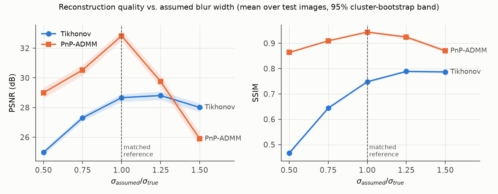
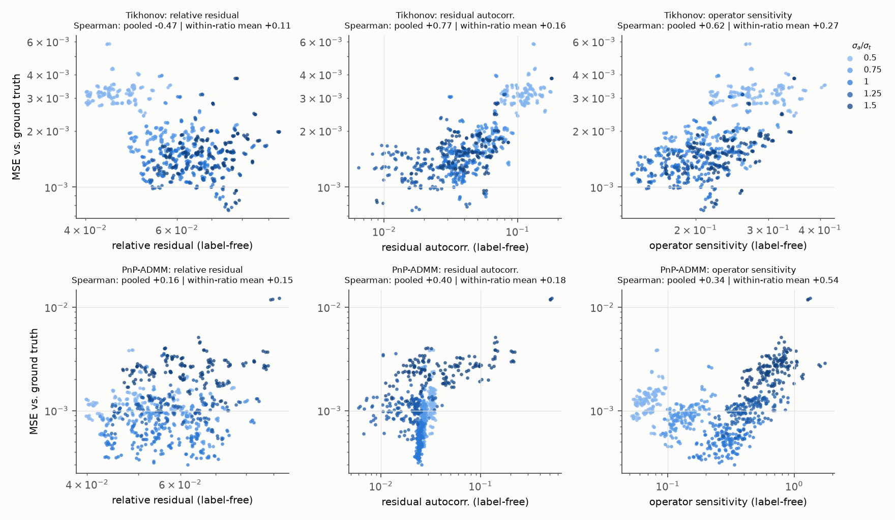
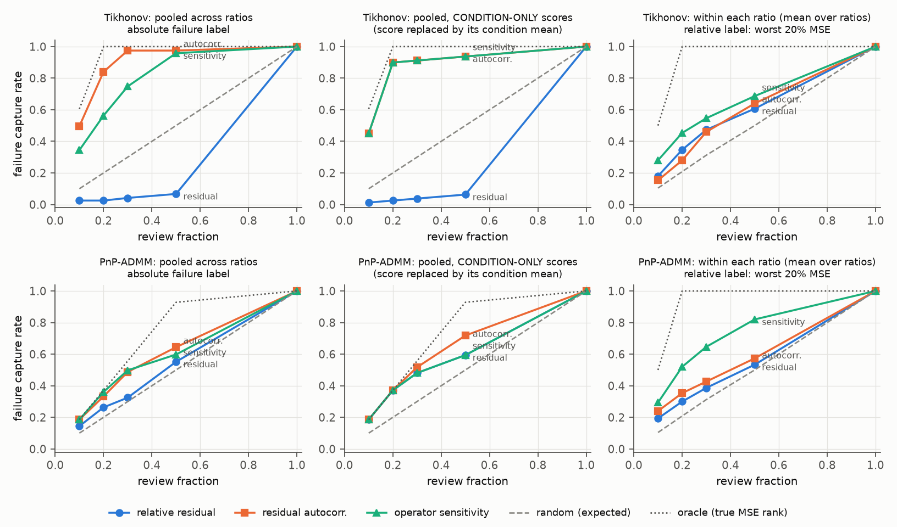
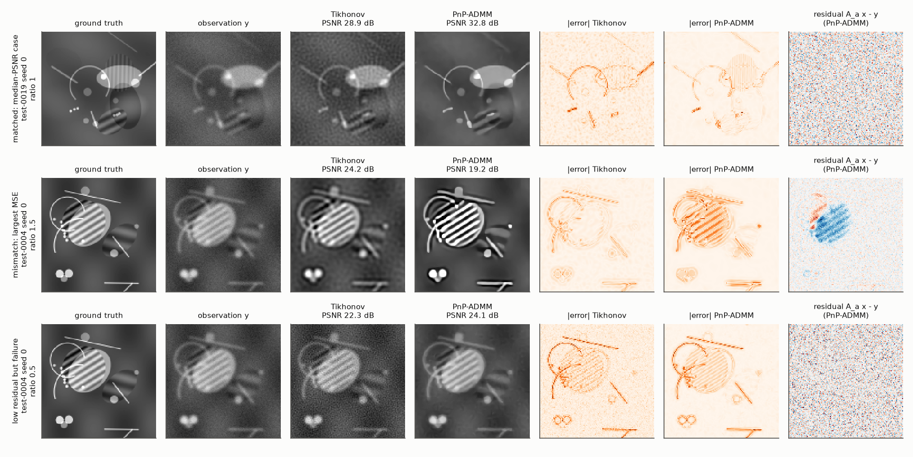

# Reliable Reconstruction under Measurement Mismatch

**Gaussian deblurring with Tikhonov and Plug-and-Play ADMM when the assumed blur is wrong, and whether ground-truth-free scores flag the resulting failures. A reproducible simulation study.**

*Portfolio project. Implementation and experiments were assisted by LLM-based coding tools; see `AI_USAGE.md`. All numbers below are generated from the CSV files in `results/` by `python -m reconstruction_mismatch report`. Synthetic phantoms only in the main study; no claim of clinical validity or methodological novelty.*

## 1. Motivation

Model-based image reconstruction assumes a forward operator. In practice the operator is only approximately known (a point-spread function measured on a different day, a mis-estimated blur width). A reconstruction can then be *consistent with the data under the assumed operator* and still be wrong. If such failures cannot be seen from the data, a reviewer needs some other signal to decide which reconstructions to inspect. This project quantifies both effects in a controlled setting where the truth is known.

## 2. Research Questions

- **RQ1.** How does reconstruction accuracy change when the assumed Gaussian blur width differs from the true one, for a classical (Tikhonov) and a learned-prior (PnP-ADMM) method?
- **RQ2.** How far apart are observation consistency (data residual under the assumed operator) and actual reconstruction accuracy?
- **RQ3.** Do three ground-truth-free scores help prioritise reconstructions with large errors for review, beyond random review and beyond simply knowing the mismatch level?

## 3. Observation Model

y = A<sub>σ_true</sub> x + ε, ε ~ N(0, 0.02² I), x ∈ [0,1]<sup>128×128</sup>, σ_true = 1.5 px. A<sub>σ</sub> is circular convolution with a normalised Gaussian kernel truncated at radius ⌈4σ⌉ and renormalised to sum 1. With periodic boundaries A = F⁻¹ diag(H) F, so the forward map, its exact adjoint A* = F⁻¹ diag(conj H) F and all linear solves are FFT-diagonal. Observations are **not** clipped. Every reconstruction uses A<sub>σ_assumed</sub> with σ_assumed/σ_true ∈ {0.5, 0.75, 1.0, 1.25, 1.5}. The same y (same image, same noise realisation) is used for every method and every σ_assumed. Verified numerically (pytest): kernel normalisation; constant images preserved; FFT convolution equals a direct spatial sum, including for asymmetric kernels; the adjoint inner-product identity holds to 1e-12 relative error. Periodic boundaries are a modelling convenience, not a model of real optics; because the data are generated with the same circular model, boundary mismatch is *not* part of this study.

## 4. Reconstruction Methods

**Tikhonov.** ẑ = argmin ½‖Az − y‖² + (λ/2)‖z‖² = F⁻¹[conj(H)·Fy / (|H|² + λ)]. Checked against a dense direct solve (14×14), autograd and finite-difference gradients, and gradient descent. Clipping to [0,1] is a separate post-processing step; metrics and residual scores use the clipped output for both methods.

**PnP-ADMM.** Scaled ADMM with the proximal step replaced by a denoiser D:
x<sup>k+1</sup> = F⁻¹[(conj(H)·Fy + ρ·F(v<sup>k</sup> − u<sup>k</sup>)) / (|H|² + ρ)] (exact), v<sup>k+1</sup> = D(x<sup>k+1</sup> + u<sup>k</sup>; σ_d), u<sup>k+1</sup> = u<sup>k</sup> + x<sup>k+1</sup> − v<sup>k+1</sup>. It starts from x⁰ = v⁰ = y, u⁰ = 0, runs a fixed number K of iterations and outputs v<sup>K</sup>. With a learned denoiser there is no explicit objective being minimised and no convergence guarantee; the final relative change ‖v<sup>K</sup> − v<sup>K−1</sup>‖/‖v<sup>K−1</sup>‖ is recorded instead (median 4.3e-04 at the matched operator; no divergence or non-finite output in any of the 144×5 runs). The data step was checked against a dense solve and its optimality condition. With D = identity, the closed-form proximal-point recursion is reproduced.

**Denoiser.** A small noise-conditional residual CNN (8 conv layers, 32 channels, 56385 parameters, circular padding, input [x, σ-map]) trained only on 400 synthetic training phantoms (4000 Adam iterations, σ ~ U[0, 0.1], 2202 s on CPU). Held-out denoising on validation phantoms (fixed noise realisation):

| noise σ | noisy input PSNR | random-init model | trained model | gain vs input |
|---|---|---|---|---|
| 0.01 | 40.00 | 23.33 | 46.72 | +6.72 dB |
| 0.02 | 33.96 | 23.05 | 42.74 | +8.78 dB |
| 0.05 | 26.05 | 21.52 | 37.03 | +10.98 dB |
| 0.1 | 20.00 | 18.37 | 32.16 | +12.16 dB |

The randomly initialised network is worse than its input at every σ; the trained one improves on it at every σ.

## 5. Experimental Protocol

**Data.** Synthetic phantoms (ellipses with flat or smooth profiles, small discs, clusters of nearby small objects, thin lines and arcs, gratings of 3 to 28 cycles/image, smooth background), drawn on a 2× grid and box-averaged. Train / validation / test = 400 / 24 / 48 images, each generated from its own seed stream; split overlap is checked by hashing. Test observations: 48 images × 3 noise seeds.

**Fair tuning.** All hyper-parameters were chosen by mean PSNR on the validation images under the *matched* operator (one noise realisation each), then frozen for all mismatch levels and the test set. Tikhonov: λ over 33 log-spaced values in [1e-4, 1], selected λ = 0.0316 (validation 28.27 dB). PnP: ρ ∈ {0.05, 0.1, 0.2, 0.5, 1}, σ_d ∈ {0.01, 0.02, 0.03, 0.05, 0.08}, K ∈ {5, 10, 20, 30, 40}, selected ρ = 0.1, σ_d = 0.05, K = 40 (validation 32.77 dB). K = 40 is the grid edge. A validation-only check with longer runs (`scripts/check_iterations.py`) gave +0.001 dB at K = 60 and -0.066 dB at K = 100 relative to K = 40, so the grid was kept. The matched condition is shown as a *reference*, not as an optimum or upper bound.

**Code boundary.** The reconstruction stage reads only `observations.npz` (y). Ground truth and σ_true are read by simulation, tuning (validation) and evaluation only; a test enforces this by disabling the ground-truth loaders during the run stage.

**Label-free scores** (higher = more suspicious, fixed in advance): (i) relative residual ‖A<sub>a</sub>x̂ − y‖/‖y‖; (ii) residual autocorrelation, the mean |R(d)|/R(0) of the mean-centred residual over the 48 lags with |dy|,|dx| ≤ 3, d ≠ 0 (circular, via FFT); (iii) operator sensitivity ‖x̂(σ_a(1+δ)) − x̂(σ_a(1−δ))‖ / (2δ‖x̂‖), δ = 0.05 *relative* (a ±5% change of σ_a), computed by re-running the same reconstructor on the same y. Sensitivity is a local perturbation measure, **not** a calibrated or posterior uncertainty.

**Failure labels** (fixed on validation before testing). *Absolute*: PSNR below the method's median validation PSNR at the matched operator minus 3 dB, giving thresholds 25.35 dB (Tikhonov) and 30.03 dB (PnP). *Relative* (auxiliary): the worst 20% by MSE within each (method, ratio, noise seed). **Review curves**: reconstructions are ranked by score and the top k = ⌈f·n⌉ are reviewed, f ∈ {10, 20, 30, 50, 100}%. The capture rate is the fraction of failures reviewed. Ties are split proportionally (the expectation under random tie-breaking). The random-review expectation is k/n and the oracle (true-MSE ranking) is min(k, F)/F. Capture is undefined when F = 0. Two evaluations are kept apart: **(A) within each mismatch condition** and **(B) pooled across conditions**. Because σ_true is fixed here, σ_assumed alone identifies the mismatch level, so pooled performance can merely reflect the condition. To test this, each score is compared with its **condition-only** version (the score replaced by its mean over the condition). **Statistics**: 95% percentile intervals from a cluster bootstrap over the 48 test images (2000 resamples; noise seeds and conditions of an image are resampled together). With 48 images these intervals are exploratory.

## 6. Results (RQ1)

<figure><figcaption>Figure 1. Mean PSNR and SSIM over 48 test images (3 noise seeds each) versus σ_assumed/σ_true; bands are 95% image-level cluster-bootstrap intervals.</figcaption></figure>

| method | σa/σt | PSNR dB [95% CI] | SSIM [95% CI] | abs. failures | runtime / image |
|---|---|---|---|---|---|
| Tikhonov | 0.5 | 24.98 [24.80, 25.13] | 0.466 [0.459, 0.473] | 107/144 | 0.1 ms |
| Tikhonov | 0.75 | 27.31 [27.08, 27.51] | 0.644 [0.638, 0.649] | 3/144 | 0.1 ms |
| Tikhonov | 1 (matched ref.) | 28.66 [28.39, 28.90] | 0.748 [0.744, 0.752] | 3/144 | 0.1 ms |
| Tikhonov | 1.25 | 28.81 [28.51, 29.08] | 0.789 [0.785, 0.793] | 3/144 | 0.3 ms |
| Tikhonov | 1.5 | 28.01 [27.70, 28.29] | 0.787 [0.781, 0.792] | 3/144 | 0.1 ms |
| PnP-ADMM | 0.5 | 29.00 [28.63, 29.35] | 0.864 [0.859, 0.868] | 113/144 | 1013.6 ms |
| PnP-ADMM | 0.75 | 30.53 [30.17, 30.87] | 0.910 [0.906, 0.913] | 43/144 | 1041.4 ms |
| PnP-ADMM | 1 (matched ref.) | 32.83 [32.50, 33.16] | 0.944 [0.940, 0.948] | 3/144 | 1007.9 ms |
| PnP-ADMM | 1.25 | 29.75 [29.36, 30.13] | 0.925 [0.919, 0.930] | 85/144 | 1040.5 ms |
| PnP-ADMM | 1.5 | 25.89 [25.45, 26.29] | 0.870 [0.863, 0.876] | 144/144 | 1011.6 ms |

At the matched operator PnP-ADMM exceeds Tikhonov by 4.17 dB [3.94, 4.40]. The learned prior is, however, much less tolerant of mismatch. Relative to its own matched result, PnP's PSNR changes by -3.83 dB at ratio 0.5 and -6.94 dB at ratio 1.5. Tikhonov's changes by -3.69 dB and -0.66 dB. At ratio 1.5 the ordering reverses in PSNR: PnP trails Tikhonov by 2.12 dB (PnP − Tikhonov = -2.12 [-2.37, -1.87]) and better on 0% of images. Its SSIM is still higher (+0.083), so the two metrics disagree on which output is better. Over-estimating the blur makes PnP over-sharpen (halos and exaggerated stripes, Fig. 4 middle row); under-estimating leaves residual blur. Notably, the matched operator is *not* Tikhonov's best setting under a λ tuned at the matched operator: ratio 1.25 is +0.144 dB [+0.098, +0.187] better than matched (on 85% of images). A plausible but untested explanation is that a slightly wider assumed kernel boosts mid frequencies that the λ-penalty otherwise over-shrinks. On the CPU (batched), Tikhonov takes well under 1 ms per image and PnP (40 iterations) 1.01 s per image. The sensitivity score adds two reconstructions (2.05 s per image for PnP). No run diverged or produced non-finite values.

## 7. Failure Analysis (RQ2, RQ3)

**Observation consistency is not accuracy.** The mean relative residual rises monotonically with σ_assumed for both methods (Tikhonov 0.0461 at ratio 0.5 → 0.0699 at 1.5), whatever the error. For Tikhonov this follows from the closed form: before clipping, A<sub>a</sub>ẑ − y = −F⁻¹[λ/(|H<sub>a</sub>|² + λ)·Fy]. A narrower assumed kernel (|H<sub>a</sub>| closer to 1) therefore fits y more easily, even though the image stays blurred. As a result the residual is *lowest where Tikhonov fails most* (ratio 0.5 holds 107 of its absolute failures; every other ratio holds 3). Its pooled AUROC for Tikhonov failures is 0.10, i.e. a worse-than-random ranking. Fig. 4 (bottom row) shows a PnP failure (PSNR below threshold) whose residual looks like white noise.

<figure><figcaption>Figure 2. Label-free scores versus true MSE for every test reconstruction (log-log), coloured by σ_assumed/σ_true.</figcaption></figure>

| method | score | Spearman vs MSE, pooled [95% CI] | AUROC failure, pooled [95% CI] | Spearman within ratio 1.0 [95% CI] | Spearman within, range over ratios |
|---|---|---|---|---|---|
| Tikhonov | relative residual | -0.47 [-0.60, -0.37] | 0.10 [0.03, 0.19] | +0.05 [-0.27, +0.34] | +0.03 to +0.29 |
| Tikhonov | residual autocorrelation | +0.77 [+0.71, +0.82] | 0.95 [0.91, 0.98] | -0.07 [-0.32, +0.18] | -0.07 to +0.44 |
| Tikhonov | operator sensitivity | +0.62 [+0.53, +0.70] | 0.86 [0.83, 0.90] | +0.26 [-0.04, +0.50] | +0.06 to +0.54 |
| PnP-ADMM | relative residual | +0.16 [+0.04, +0.27] | 0.58 [0.51, 0.65] | +0.05 [-0.26, +0.32] | +0.05 to +0.20 |
| PnP-ADMM | residual autocorrelation | +0.40 [+0.30, +0.50] | 0.68 [0.63, 0.72] | +0.35 [+0.14, +0.53] | -0.01 to +0.45 |
| PnP-ADMM | operator sensitivity | +0.34 [+0.30, +0.37] | 0.64 [0.59, 0.68] | +0.39 [+0.09, +0.62] | +0.39 to +0.65 |

**Pooled detection mostly reflects the mismatch level.** On the absolute label, Tikhonov's failures are concentrated at ratio 0.5. There, residual autocorrelation reviews 0.84 of failures at 20% review, but its condition-only version does as well or better (0.90). The same holds for every score and both methods (table below; condition-only in parentheses). In this design the pooled numbers say "this σ_assumed is suspicious", not "this image is wrong", and they would not carry over to a setting where σ_true varies.

| method | ranking | 10% | 20% | 30% | 50% |
|---|---|---|---|---|---|
| Tikhonov | relative residual | 0.03 (0.01) | 0.03 (0.03) | 0.04 (0.04) | 0.07 (0.06) |
| Tikhonov | residual autocorrelation | 0.50 (0.45) | 0.84 (0.90) | 0.97 (0.91) | 0.97 (0.94) |
| Tikhonov | operator sensitivity | 0.34 (0.45) | 0.56 (0.90) | 0.75 (0.91) | 0.96 (0.94) |
| Tikhonov | random (expected) | 0.10 | 0.20 | 0.30 | 0.50 |
| Tikhonov | oracle (true MSE) | 0.61 | 1.00 | 1.00 | 1.00 |
| PnP-ADMM | relative residual | 0.14 (0.19) | 0.26 (0.37) | 0.32 (0.48) | 0.55 (0.59) |
| PnP-ADMM | residual autocorrelation | 0.19 (0.19) | 0.33 (0.37) | 0.49 (0.52) | 0.64 (0.72) |
| PnP-ADMM | operator sensitivity | 0.19 (0.19) | 0.36 (0.37) | 0.50 (0.48) | 0.60 (0.59) |
| PnP-ADMM | random (expected) | 0.10 | 0.20 | 0.30 | 0.50 |
| PnP-ADMM | oracle (true MSE) | 0.19 | 0.37 | 0.56 | 0.93 |

**Within a condition, sensitivity carries a modest signal.** The relative label removes the condition effect by construction (condition-only equals random review at 20%). On it, operator sensitivity is the strongest score for both methods: pooled capture@20% 0.33 [0.24, 0.45] for PnP and 0.37 [0.24, 0.51] for Tikhonov, against 0.20 for random review and 0.96 for the oracle. The relative residual (0.27 [0.14, 0.39] for PnP) and the autocorrelation (0.24 [0.17, 0.34]) are closer to random. The intervals overlap, so the ordering of the scores is suggestive rather than established. For PnP the within-condition Spearman correlation of sensitivity with MSE is positive at every ratio (table above). Its *level*, however, tracks σ_assumed (mean 0.07 at ratio 0.5 vs 0.71 at 1.5). Under-estimated cases therefore score low despite large errors (Fig. 2): sensitivity flags over-sharpening better than leftover blur. Within individual conditions, sensitivity's capture@20% on the relative label ranges from 0.33 (ratio 1.5) to 0.67 (ratio 0.75) for PnP (all values: `failure_capture_within.csv`).

On the absolute label, within-condition capture is mostly uninformative: the matched and mildly mismatched conditions contain a single failing image per noise seed for Tikhonov (and for PnP at the matched operator), so capture there is 0 or 1. Ratio 1.5 for PnP fails on every image (capture equals the review fraction).

<figure><figcaption>Figure 3. Failure capture versus review fraction. Left: pooled, absolute label. Middle: same with condition-only scores. Right: within-condition, relative label (mean over ratios).</figcaption></figure>

<figure><figcaption>Figure 4. Representative cases chosen by fixed rules (PnP-ADMM, noise seed 0): matched median-PSNR case; largest-MSE mismatched case; largest-MSE case among the lowest-residual quartile that is an absolute failure. Residual = A_assumed x̂ − y.</figcaption></figure>

## 8. Extensions

**E1: public biomedical images with simulated blur (OrganCMNIST, 128×128).** These are abdominal CT organ crops from MedMNIST+ v3.0 (CC BY 4.0, md5-verified; official split by CT scan, 115/16/70 scans). We used 24 validation and 48 test slices sampled from the official validation and test splits, applied the *same simulated* blur and noise, and re-tuned all hyper-parameters on the validation slices. This is a *public-biomedical-image-based synthetic observation experiment*: the released slices already contain CT noise and resampling blur and serve as "ground truth"; nothing here is a CT measurement or a clinical evaluation. The PnP denoiser is the phantom-trained CNN (domain shift). Its tuning chose the grid boundary for all three hyper-parameters (ρ = 0.05, σ_d = 0.08, K = 5) on a flat validation surface, and the grid was not widened afterwards, so PnP may be slightly under-tuned. Per-slice scan IDs are not released, so slices from one scan can co-occur and the bootstrap (over slices) is optimistic.

| PSNR dB [95% CI] | σa/σt=0.5 | σa/σt=0.75 | σa/σt=1 | σa/σt=1.25 | σa/σt=1.5 |
|---|---|---|---|---|---|
| Tikhonov | 24.00 [23.6, 24.4] | 26.63 [26.1, 27.1] | 28.53 [28.0, 29.1] | 28.94 [28.2, 29.6] | 27.72 [26.9, 28.6] |
| PnP-ADMM | 28.95 [27.8, 30.1] | 30.79 [29.6, 32.0] | 32.35 [31.1, 33.6] | 30.08 [28.8, 31.4] | 26.68 [25.4, 28.1] |

The synthetic findings carry over qualitatively. PnP leads at the matched operator by 3.82 dB [3.06, 4.64] and trails Tikhonov at ratio 1.5 by 1.05 dB (PnP − Tikhonov = -1.05, [-1.60, -0.41]). Tikhonov is again better at ratio 1.25 than at matched (+0.41 dB). The relative residual again rises with σ_assumed (0.037 → 0.057; pooled AUROC for Tikhonov failures 0.29). One difference: on these images the autocorrelation and sensitivity scores do somewhat better than their condition-only versions for PnP (pooled capture@20%, absolute label: 0.52 for sensitivity vs 0.40 condition-only). On the relative label they reach 0.40 [0.28, 0.52] (sensitivity) against 0.20 for random review. Given the optimistic intervals and a single dataset, we read this as a hypothesis for follow-up, not a finding.

**E2: a pretrained denoiser (FFDNet, KAIR model zoo, MIT licence).** This is the published grey-scale FFDNet, trained by its authors on natural photographs, loaded into a re-implemented topology (strict key and shape match). It replaced the small CNN in PnP on the *quick* profile only (12 test phantoms × 2 seeds; the full scale would take ~1.5 h on this CPU) and was re-tuned on validation data (ρ = 0.05 at the grid edge, σ_d = 0.05, K = 30). As a pure denoiser on the held-out phantoms it is slightly *better* than our CNN (gain +9.06 vs +8.78 dB at σ = 0.02). Inside PnP on the same test observations it is worse at the matched operator (31.37 vs 32.68 dB). Under blur under-estimation (ratio 0.5) it degrades much more (25.54 vs 28.59 dB, SSIM 0.52) without diverging (median final relative change 1.5e-04); we did not investigate the cause. At ratio 1.5 it again falls below Tikhonov (PnP − Tikhonov = -2.73 dB). Denoising quality alone therefore did not predict PnP accuracy or robustness to mismatch here; with 12 images and a boundary-selected ρ this is an anecdote, not a comparison of priors.

## 9. Limitations

- **Synthetic, simple, periodic.** Phantoms are not cells or tissue; blur is isotropic Gaussian with circular boundaries; noise is white Gaussian. Only the blur width is mismatched (not the kernel shape, boundary or noise model).
- **Small data.** 48 test images (3 noise seeds each are *not* independent samples), 24 validation images and one noise realisation per validation image for tuning; intervals are exploratory. Small samples are unstable here. On the quick profile (12 of the same test images, 2 seeds), the within-condition Spearman correlation of Tikhonov's relative residual with MSE at the matched operator was -0.35, against +0.05 on the full set.
- **One prior, one tuning protocol.** One small CNN trained on the same phantom family as the test images (favourable to PnP at the matched operator); hyper-parameters tuned only at the matched operator. Re-tuning per σ_assumed, or schedules such as decreasing σ_d, could change the mismatch curves.
- **Fixed σ_true confounds pooled evaluation.** The condition-only diagnostic exposes this but does not replace an experiment with varying σ_true.
- **Scores.** Sensitivity triples the reconstruction cost and only probes the σ direction. None of the scores is calibrated, and none is an uncertainty estimate.
- **No clinical meaning.** The OrganCMNIST extension adds simulated blur and noise to public CT slices; it is not a CT reconstruction or a clinical evaluation.

## 10. Reproducibility

Python 3.12, PyTorch 2.15 (CPU), Windows 11. The exact versions are in `requirements-lock.txt` and each `results/<run>/environment.json`, which also records the code hash, git state and device checks. Each run directory stores the resolved config, data split hashes, checkpoint hash, per-image CSV and stage status. Cached stages are keyed by data, config, checkpoint and code hashes. A forced recompute of the quick profile reproduced all non-timing per-image values bit-for-bit.

```
python -m venv .venv && .venv\Scripts\activate          # (source .venv/bin/activate on macOS/Linux)
pip install torch --index-url https://download.pytorch.org/whl/cpu && pip install -e ".[test]"
pytest -m "not slow"                                    # numerical checks
python -m reconstruction_mismatch reproduce --profile quick   # ~13 min on a 4-core laptop CPU (committed denoiser restored)
python -m reconstruction_mismatch reproduce --profile full    # ~55 min; retraining the denoiser adds ~35 min
```
